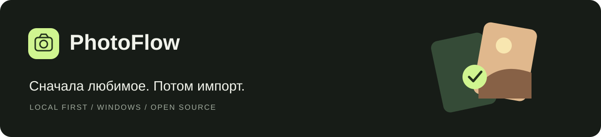

<p align="center"></p>

<p align="center"><strong>Сначала выберите любимое. Потом импортируйте.</strong></p>
<p align="center">Windows 11 · WinUI 3 · .NET 10 · локальный каталог</p>
<p align="center"><a href="https://github.com/sashasychev05-sketch/PhotoFlow/releases">Скачать preview</a> · <a href="docs/GETTING_STARTED.md">Начать работу</a> · <a href="docs/STATUS.md">Что проверено</a> · <a href="docs/REUSE.md">Открытые компоненты</a></p>

PhotoFlow помогает отбирать фото и видео **до импорта**. Откройте папку или подключите телефон, отметьте удачные кадры и перенесите только выбранное. Оригиналы остаются на месте.

> **Ранняя версия 0.2.** Локальная галерея и каталог работают. USB проверяется отдельно по устройствам; iPhone, RAW-декодирование и сохраняемая очередь ещё не подтверждены. [Подробный статус →](docs/STATUS.md)

## Три понятных действия

1. **Откройте источник.** Локальная папка или USB-устройство. Индексирование получает список файлов, без предварительного импорта всей коллекции.
2. **Оставьте любимое.** Галочка — выбрать для импорта. Звезда — сохранить в избранном PhotoFlow. Поиск и массовый выбор работают по всему SQL-каталогу.
3. **Импортируйте выбранное.** Проверьте состав набора и папку назначения. PhotoFlow проверяет размер и SHA-256 записанных файлов; совпадающие имена получают суффикс.

## Уже есть

| Возможность | Состояние |
|---|---|
| Тёмная галерея, подгрузка страниц, виртуализация, просмотр | Работает для поддерживаемых Windows форматов |
| SQLite/WAL, поиск, сортировка, фильтры, постоянные звёзды и отбор | Реализовано; SQL-проверка на 10 000 объектах |
| Выбор всех совпадений с фильтром | Весь каталог, включая ещё не показанные карточки |
| USB/WPD | Проверены список и отдельные миниатюры одного Android; см. статус |
| Оригинал для отсутствующей USB-миниатюры | Автоматическая загрузка отключена |
| Выборочный импорт и отмена | Реализовано; исходники не удаляются |
| RAW/HEIC/видео | Форматы распознаются; превью зависят от кодеков Windows. LibRaw ещё не подключён |

## Запуск

Скачайте Windows x64 архив из [Releases](https://github.com/sashasychev05-sketch/PhotoFlow/releases), распакуйте целиком и откройте **PhotoFlow.App.exe**. Нужен [.NET 10 Runtime x64](https://dotnet.microsoft.com/en-us/download/dotnet/10.0); Windows App Runtime включён в сборку. Нажмите **Демо**, чтобы попробовать интерфейс без личных фотографий.

[Первые шаги, USB и горячие клавиши →](docs/GETTING_STARTED.md)

## Разработка

Нужны Windows, .NET SDK 10 и Windows SDK / инструменты сборки WinUI. Восстановление использует зафиксированные NuGet-зависимости.

```powershell
.\scripts\photoflow.ps1 restore
.\scripts\photoflow.ps1 build
.\scripts\photoflow.ps1 test
.\scripts\photoflow.ps1 app
```

Диагностика устройства и локального источника:

```powershell
.\scripts\photoflow.ps1 devices
.\scripts\photoflow.ps1 scan --folder "D:\Pictures" --limit 100 --output "scan.ndjson"
```

```text
PhotoFlow.App             WinUI 3, карточки, отбор, просмотр
PhotoFlow.Core            источники, строгие миниатюры, проверенный перенос
PhotoFlow.Infrastructure  SQLite/WAL, локальные папки, WPD COM
PhotoFlow.Probe           консольная диагностика
PhotoFlow.Tests           xUnit, искусственные источники и каталоги
```

## Открытый код и приватность

Переиспользуются **CommunityToolkit.Mvvm**, **Microsoft.Data.Sqlite** и приёмы **WinUI Gallery**. Источники, границы заимствования и лицензии описаны в [REUSE](docs/REUSE.md) и [THIRD_PARTY_NOTICES](THIRD_PARTY_NOTICES.md). Код PhotoFlow распространяется под MIT; внешние компоненты сохраняют свои лицензии.

В репозитории — исходники, документация и сгенерированные демонстрационные иллюстрации. Локальный каталог, отметки, личные фотографии, пути и USB-идентификаторы не публикуются. [Как хранятся данные →](docs/PRIVACY.md)

[План развития](docs/ROADMAP.md) · [Внести вклад](CONTRIBUTING.md) · [Исходное ТЗ](PhotoFlow_Tech_Spec_v0.2.md)
